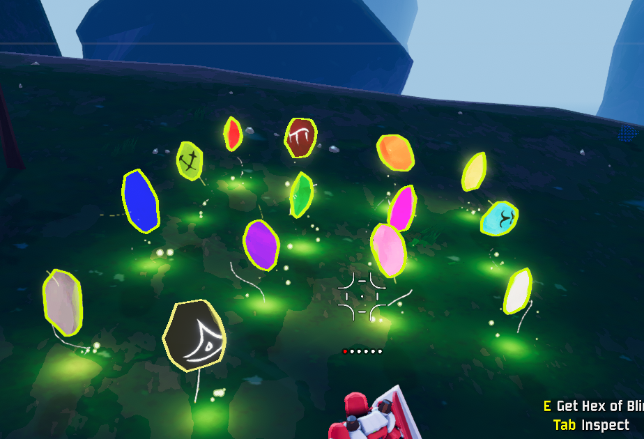

# HexTweaks

Tweaks Hallowed Concepts hexes so they only punish the player holding them.

Everyone in the lobby needs this mod, with the same version (it adds a custom buff).

## Changes

| Hex | Vanilla | HexTweaks |
|---|---|---|
| Hex of Rain | Raises the run's difficulty for everyone | Holder takes +15% damage, deals 20% less damage, has +15% cooldowns, and 10% lower attack and movement speed (per stack) |
| Hex of Patience | Hurts everyone outside the teleporter, ramping with the team's stacks | Only hurts holders, ramping with their own stacks |
| Hex of Strife | Adds Shrine of the Mountain effects to the teleporter | Holder takes +30% damage from bosses and deals 20% less damage to them (per stack) |
| Hex of Ossification | Kills give nearby enemies barrier | After a kill, holder gets a debuff (shown with the hex's icon) and deals 30% less damage for 5s (+2s per stack) |
| Hex of Greed | Copies your items to enemies | Holder earns 25% less gold per stack (multiplicative) |
| Hex of Mimicry | Spawns Mimics | Mimics only target the player who spawned them |

Every change can be turned off and tuned in `kaitorque.HexTweaks.cfg`.

With [LookingGlass](https://thunderstore.io/c/riskofrain2/p/DropPod/LookingGlass/) installed, its item stats for the changed hexes show the HexTweaks effects.

See [CHANGELOG.md](package/CHANGELOG.md) for version history.

## Hex Colors

In vanilla, every hex is the same dark stone with the same yellow-green runes. HexTweaks gives each of the 14 hexes its own stone color, with white or black runes picked for contrast, so you can tell them apart from a distance. Inventory icons are recolored to match.



| Hex | Stone | Hex | Stone |
|---|---|---|---|
| Patience | Red | Mimicry | Green |
| Pain | Maroon | Famine | Magenta |
| Misfortune | Orange | Acceleration | Cyan |
| Greed | Yellow | Rain | Blue |
| Leaping | Lime | Strife | Purple |
| Haunting | Pink | Ossification | White |
| Loss | Grey | Blindness | Black |

Colors are purely visual and client-side. Each hex's `Stone Color` and `Rune Color` can be changed in the config, and edits apply live while the game is running.

## Building

Requires the .NET SDK. Paths to the game and the r2modman profile are set in `HexTweaks.csproj` (`GameManaged` and `Profile`).

```powershell
.\package.ps1
```

This builds the plugin and creates a Thunderstore/r2modman-importable zip next to the repo folder.
